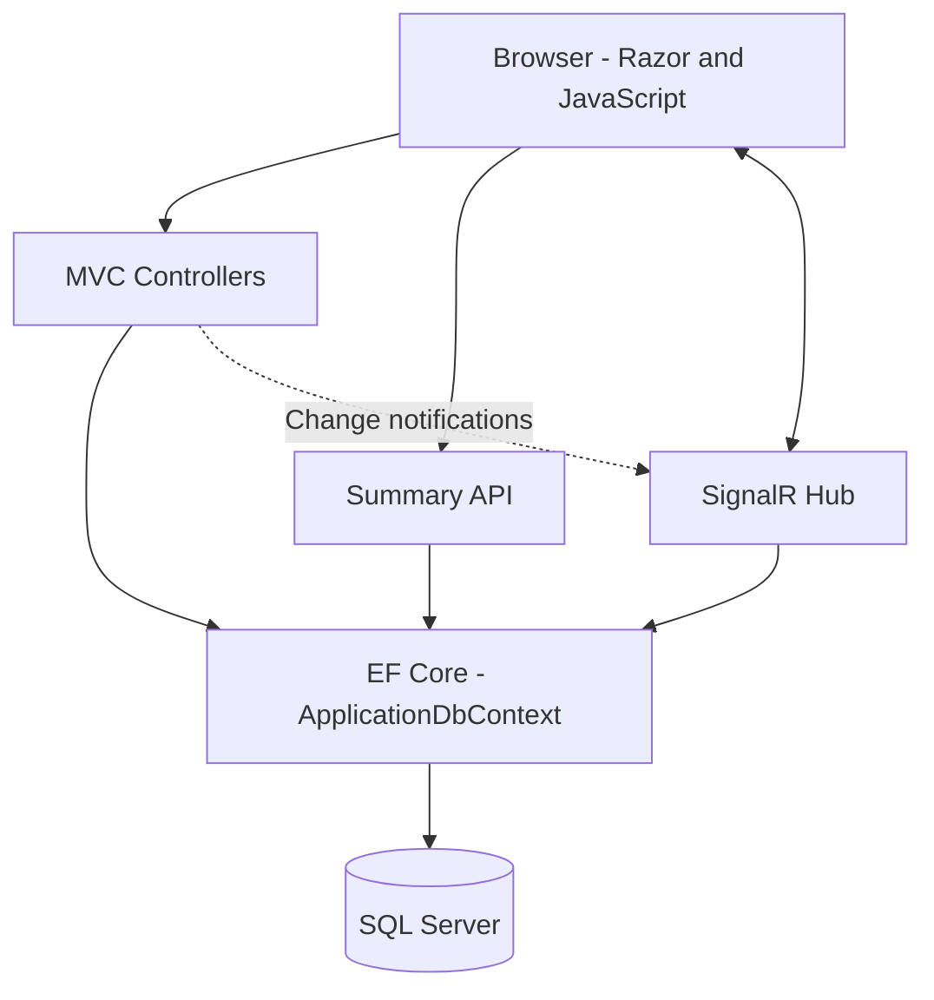

# IT Help Desk — Central de Chamados

**Full-stack ticket management | Real-time communication | HTTP caching**

**English** | [Português (BR)](README.pt-BR.md)

    

## Overview

An academic full-stack web application for managing IT support tickets. The project demonstrates persistent data storage, server-rendered interfaces, real-time updates across browser sessions and conditional HTTP requests. The application interface is in Brazilian Portuguese.

## Features

- Create, view, edit and delete support tickets.
- Manage priority (low, medium, high) and status (open, in progress, resolved).
- Track the requester, description and opening date.
- Refresh the ticket table after SignalR notifications without reloading the entire page.
- Stream ticket counts from the server every two seconds, with automatic reconnection on the client.
- Demonstrate HTTP caching, ETag validation and `304 Not Modified` responses through a dedicated interface.
- Validate form inputs on the server and use antiforgery tokens for write operations.

## Tech Stack

| Area | Technologies |
|---|---|
| Backend | C#, .NET 8, ASP.NET Core MVC |
| Data access | Entity Framework Core 8, SQL Server, migrations |
| Frontend | Razor, HTML, CSS, JavaScript, Bootstrap, jQuery |
| Real-time | ASP.NET Core SignalR |
| HTTP | Response Caching middleware, ETag, conditional GET |

## Architecture



The MVC controller handles ticket operations. The read-only summary API is separate from the real-time ticket list: the API uses a five-second response-cache policy, while the list uses `no-store`. The SignalR hub streams status counts and the controller broadcasts change notifications after successful writes.

### Main endpoints

| Route | Purpose |
|---|---|
| `/Chamados` | Ticket list and live indicators |
| `/Chamados/Create` | New ticket form |
| `/Chamados/Details/{id}` | Ticket details |
| `/Chamados/Edit/{id}` | Edit ticket |
| `/Chamados/Delete/{id}` | Delete confirmation |
| `/Chamados/DemoHttp` | HTTP caching demonstration |
| `/api/chamados/resumo` | GET: aggregate ticket counts |
| `/chamadosHub` | SignalR connection and `StreamResumo` |

### HTTP caching demonstration

The summary endpoint returns an ETag derived from a SHA-256 hash of the serialized summary. When the client sends a matching `If-None-Match` header, the endpoint can return `304 Not Modified` without a response body. If the aggregate counts change, the ETag changes after the cached response expires.

## Getting Started

### Requirements

- .NET 8 SDK and SQL Server (e.g. SQL Server Express).
- A local SQL Server instance accessible using Windows authentication, or a compatible connection string configured locally.
- Internet access to load the SignalR browser client from its CDN.

### Run locally

From a terminal in the repository root:

```powershell
git clone https://github.com/luansorrilha/it-helpdesk.git
cd it-helpdesk
cd CentralChamados
dotnet restore
```

The default connection string in `CentralChamados/appsettings.json` targets `localhost\SQLEXPRESS` and the `CentralChamadosDB` database using Windows authentication. Adjust it locally if your instance differs. Do not commit passwords or production connection strings. `TrustServerCertificate=True` is intended for local development only.

If the EF Core CLI is not installed, install a compatible 8.x version:

```powershell
dotnet tool install --global dotnet-ef --version 8.0.31
```

Then create the local database using the included migration and start the app:

```powershell
dotnet ef database update
dotnet run --launch-profile http
```

Open `http://localhost:5261` (or the address printed by the application). If HTTPS redirection applies, use the HTTPS launch profile and trust the local development certificate as needed.

### Suggested manual tests

1. Create a ticket with fictional data and verify it appears in the list.
2. Open the list in two browser windows; edit a ticket in one and check the live update in the other.
3. Open the HTTP cache demonstration and perform a normal request followed by a conditional request without changing the aggregate counts.
4. Verify status changes and deletion using disposable test tickets only.

## Project Structure

```text
CentralChamados.slnx
CentralChamados/
  Controllers/
  Data/
  Hubs/
  Migrations/
  Models/
  Properties/
  Views/
  wwwroot/
  appsettings.json
  appsettings.Development.json
  CentralChamados.csproj
  Program.cs
```

## Limitations

This is an academic demonstration, not a production-ready service desk. Authentication and role-based authorization are not implemented. Run it locally with fictional data; do not expose a writable instance or real support requests to the public. No public live deployment or automated test results are claimed.

## Author

Luan Sorrilha · [GitHub](https://github.com/luansorrilha) · [LinkedIn](https://www.linkedin.com/in/luansorrilha)
