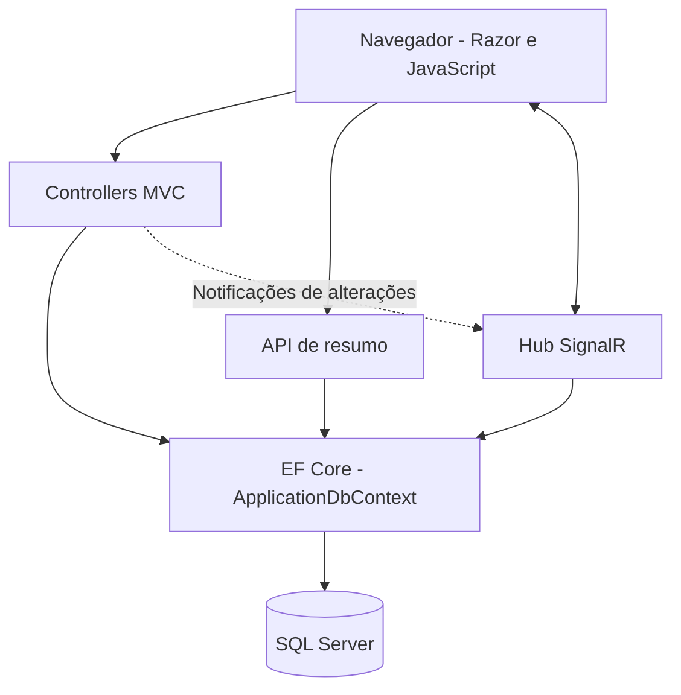

# IT Help Desk — Central de Chamados

**Gerenciamento de chamados full-stack | Comunicação em tempo real | Cache HTTP**

[English](README.md) | **Português (BR)**

    

## Visão Geral

Aplicação web full-stack acadêmica para gerenciamento de chamados de suporte de TI. O projeto demonstra persistência de dados, interfaces renderizadas no servidor, atualizações em tempo real entre navegadores e requisições HTTP condicionais. A interface está em português brasileiro.

## Funcionalidades

- Cadastro, consulta, edição e exclusão de chamados.
- Gerenciamento de prioridades (baixa, média, alta) e status (aberto, em andamento, resolvido).
- Registro do solicitante, descrição e data de abertura.
- Atualização da tabela após notificações SignalR, sem recarregar toda a página.
- Streaming dos indicadores a cada dois segundos, com reconexão automática no cliente.
- Demonstração de cache HTTP, validação por ETag e respostas `304 Not Modified` em uma interface dedicada.
- Validação de formulários no servidor e uso de tokens antiforgery nas operações de escrita.

## Tecnologias

| Área | Tecnologias |
|---|---|
| Backend | C#, .NET 8, ASP.NET Core MVC |
| Acesso a dados | Entity Framework Core 8, SQL Server, migrations |
| Frontend | Razor, HTML, CSS, JavaScript, Bootstrap, jQuery |
| Tempo real | ASP.NET Core SignalR |
| HTTP | Middleware Response Caching, ETag, GET condicional |

## Arquitetura



O controller MVC gerencia as operações dos chamados. A API de resumo, somente para leitura, é separada da listagem em tempo real: a API utiliza uma política de cache de cinco segundos, enquanto a listagem utiliza `no-store`. O hub SignalR transmite os indicadores e o controller notifica os clientes após operações de escrita bem-sucedidas.

### Principais endpoints

| Rota | Finalidade |
|---|---|
| `/Chamados` | Listagem e indicadores em tempo real |
| `/Chamados/Create` | Cadastro de chamado |
| `/Chamados/Details/{id}` | Detalhes do chamado |
| `/Chamados/Edit/{id}` | Edição do chamado |
| `/Chamados/Delete/{id}` | Confirmação de exclusão |
| `/Chamados/DemoHttp` | Demonstração de cache HTTP |
| `/api/chamados/resumo` | GET: contagens agregadas de chamados |
| `/chamadosHub` | Conexão SignalR e `StreamResumo` |

### Demonstração de cache HTTP

O endpoint de resumo retorna um ETag derivado de um hash SHA-256 do resumo serializado. Quando o cliente envia um cabeçalho `If-None-Match` correspondente, o endpoint pode retornar `304 Not Modified` sem corpo. Se as contagens agregadas mudarem, o ETag muda após expirar a resposta em cache.

## Como Executar

### Pré-requisitos

- SDK .NET 8 e SQL Server (por exemplo, SQL Server Express).
- Instância local do SQL Server acessível por autenticação do Windows ou string de conexão compatível configurada localmente.
- Acesso à internet para carregar o cliente SignalR pelo CDN.

### Execução local

Em um terminal:

```powershell
git clone https://github.com/luansorrilha/it-helpdesk.git
cd it-helpdesk
cd CentralChamados
dotnet restore
```

A string de conexão padrão em `CentralChamados/appsettings.json` utiliza `localhost\SQLEXPRESS` e o banco `CentralChamadosDB`, com autenticação do Windows. Ajuste localmente caso sua instância seja diferente. Não versione senhas ou strings de conexão de produção. O parâmetro `TrustServerCertificate=True` destina-se ao desenvolvimento local.

Caso a ferramenta EF Core CLI não esteja instalada, instale uma versão 8.x compatível:

```powershell
dotnet tool install --global dotnet-ef --version 8.0.31
```

Crie o banco local utilizando a migration existente e execute o projeto:

```powershell
dotnet ef database update
dotnet run --launch-profile http
```

Acesse `http://localhost:5261` (ou o endereço exibido pela aplicação). Caso haja redirecionamento HTTPS, utilize o perfil de execução HTTPS e confie no certificado local de desenvolvimento, se necessário.

### Testes manuais sugeridos

1. Cadastre um chamado com dados fictícios e confira a listagem.
2. Abra a listagem em duas janelas do navegador; edite um chamado em uma delas e verifique a atualização na outra.
3. Abra a demonstração de cache HTTP e faça uma consulta normal seguida de uma condicional sem alterar as contagens.
4. Verifique a mudança de status e a exclusão usando somente chamados descartáveis de teste.

## Estrutura do Projeto

```text
CentralChamados.slnx
CentralChamados/
  Controllers/
  Data/
  Hubs/
  Migrations/
  Models/
  Properties/
  Views/
  wwwroot/
  appsettings.json
  appsettings.Development.json
  CentralChamados.csproj
  Program.cs
```

## Limitações

Este é um projeto acadêmico demonstrativo, não um sistema de chamados pronto para produção. Não há autenticação de usuários nem autorização baseada em perfis. Execute localmente com dados fictícios; não exponha uma instância pública com operações de escrita ou chamados reais. Não há alegação de deploy público nem de resultados de testes automatizados.

## Autor

Luan Sorrilha · [GitHub](https://github.com/luansorrilha) · [LinkedIn](https://www.linkedin.com/in/luansorrilha)
